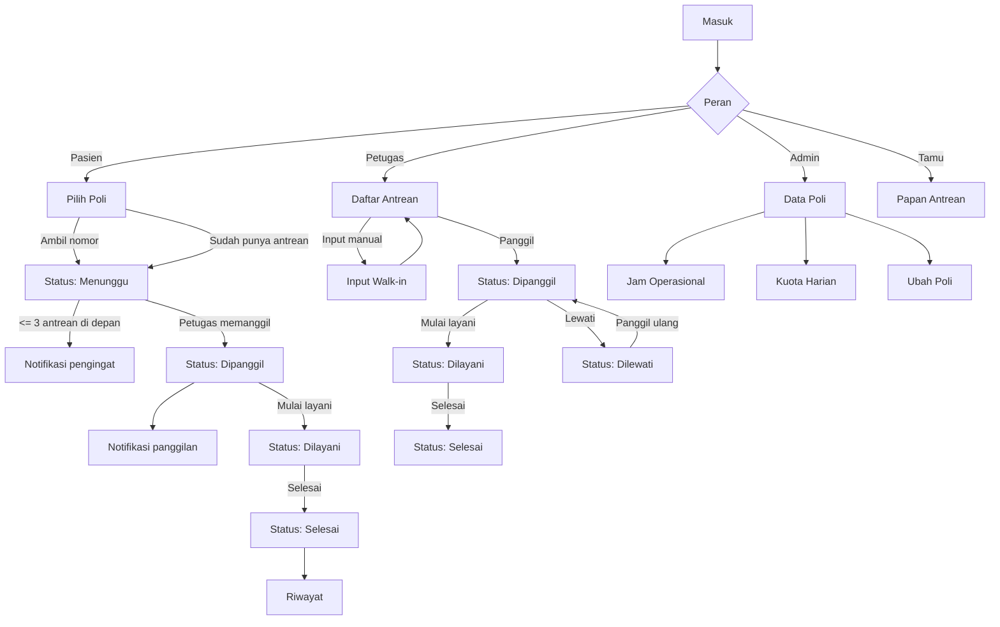

# Antrean Puskesmas — Design Specification

Design export of the running Laravel application at `http://127.0.0.1:8000`.
Captured on **26 October 2026** from the live UI (1440 desktop and 390 mobile),
with the complete patient → officer → admin flow exercised first.

- **26 screens** (23 desktop, 3 mobile)
- **4 role areas** (public/guest, patient, officer, admin)
- **Design system**: 13 core colors + status colors, type scale, buttons, badges, inputs, cards, table, topbar
- **User flow** verified end-to-end (see `flow-check.json`)

---

## 1. Product & roles

| Role | Entry point | What they do |
|---|---|---|
| Guest / Tamu | `/papan` | View the public queue board (serving, called, next numbers). Cannot take a number. |
| Pasien | `/pasien/poli` | Register, take an online queue number, monitor status, read notifications, view history. |
| Petugas | `/petugas/antrean` | Call, serve, finish, skip, and recall queues; add walk-in (manual) queues. |
| Admin | `/admin/poli` | Manage policlinics, operating hours, and daily quotas. Can also view the officer queue. |

The system manages **queues only**, not medical records or clinical services.

---

## 2. Design foundations

### 2.1 Color

| Token | Hex | Usage |
|---|---|---|
| `--utama` | `#0F766E` | Primary actions, active nav, focus ring |
| `--utama-tua` | `#115E59` | Headings on tinted surfaces, queue numbers |
| `--utama-muda` | `#CCFBF1` | Active nav background, info banners, rings |
| `--latar` | `#F1F5F9` | App background |
| `--kartu` | `#FFFFFF` | Cards, topbar, inputs |
| `--teks` | `#0F172A` | Body text |
| `--teks-lembut` | `#64748B` | Secondary text, metadata, table headers |
| `--garis` | `#E2E8F0` | Borders and dividers |
| `--merah` | `#DC2626` | Errors, closed state, skip badge |
| `--hijau` | `#16A34A` | Success, open state, finish action |
| `--kuning` | `#D97706` | Called state, admin role |
| `--biru` | `#2563EB` | Served state, officer role |
| `--abu` | `#475569` | Neutral buttons, waiting state text |

Status surfaces:

| State | Background | Text |
|---|---|---|
| Menunggu | `#E2E8F0` | `#475569` |
| Dipanggil | `#FEF3C7` | `#D97706` |
| Dilayani | `#DBEAFE` | `#2563EB` |
| Selesai | `#DCFCE7` | `#16A34A` |
| Dilewati | `#FEE2E2` | `#DC2626` |

Role surfaces: Pasien `#CCFBF1`/`#115E59`, Petugas `#DBEAFE`/`#2563EB`,
Admin `#FEF3C7`/`#D97706`.

### 2.2 Typography

Font stack: **Segoe UI**, `system-ui`, `-apple-system`, Roboto, sans-serif.
Base size **15px**, line-height **1.55** (23.25px). The Figma plugin falls back
to Inter if Segoe UI is unavailable on the operating system.

| Style | Size / line | Weight | Used for |
|---|---|---|---|
| Display (Figma only) | 60 / 68 | 700 | Cover title |
| H1 | 23.2 / 36 | 700 | Page titles (`Pilih Poli`, `Daftar Antrean Hari Ini`) |
| H2 | 17.6 / 27 | 700 | Card and section titles |
| H3 | 16 / 25 | 700 | Sub-section titles |
| Body | 15 / 23.25 | 400 | Default text |
| Small / muted | 14.72 / 22.8 | 400 | Helper text, descriptions |
| Label | 12 / 18 | 600–700 | Table headers, form labels, badges |
| Button | 14.72 / 21 | 600 | Button labels |
| Tiny | 13.12 / 20.3 | 400 | Footer, timestamps, route metadata |

### 2.3 Spacing, radius, elevation

- Spacing scale: **4, 8, 12, 16, 20, 24, 32, 40, 48 px**
- Page container: max-width `1080px`, horizontal padding `20px`
- Card padding: `18.4px 20px` (≈ 18/20)
- Control height: `40px`; small button: `32px`
- Radius: `6px` (code chip), `8px` (buttons, inputs, nav pills), `12px` (cards,
  alerts), `999px` (badges / chips)
- Card shadow: `0 1px 3px rgba(15,23,42,.08), 0 4px 16px rgba(15,23,42,.06)`
- Sticky topbar: white, 1px bottom border, `z-index: 10`

---

## 3. Components

### 3.1 Topbar

Logo `🩺 Antrean Puskesmas` (700, teal-dark) + role navigation + right cluster
(user name, role badge, `Keluar` outline button, small size). Active nav item:
mint background `#CCFBF1`, teal-dark text, 600 weight, 8px radius. On mobile the
bar wraps into two rows.

### 3.2 Buttons

| Variant | Fill | Text / border | Use |
|---|---|---|---|
| Primary | `#0F766E` | white | Ambil Antrean, Panggil, Masuk |
| Outline | white | teal text + teal border | Muat Ulang, back, secondary |
| Success | `#16A34A` | white | Selesai |
| Danger outline | white | red text + red border | Lewati, Hapus |
| Neutral | `#475569` | white | Default `.btn` |
| Disabled | 50% opacity | white | Queue already taken / quota empty |

Sizes: default `8px 15px` / 14.7px text; small `4.8px 9.6px` / 13.1px text.
Full-width variant (`btn--lebar`) used in forms and poli cards.

### 3.3 Badges

Pill shape, 11.7px bold, `2px 8.8px` padding, tinted background, no border except
role badges (1px `#E2E8F0`). Text labels are always present (never color-only).

### 3.4 Inputs & selects

Label above field in body size. Field: white, 1px `#E2E8F0`, radius 8px, padding
`8.8px 11.2px`, 15.2px text. Focus: 1px teal border + 2px mint outline. Selects
use the same box with a `▾` chevron. Checkbox rows align horizontally with a
14.7px label.

### 3.5 Cards

Base card: white, 1px border, 12px radius, card shadow, `18/20px` padding.
Variants:

- **Highlight card** (`kartu--sorot`): 5px teal left border, mint gradient tint,
  used for “already has an active queue”.
- **Center card** (`kartu--tengah`): max-width 460px, centered, used for auth,
  empty states, manual input, and edit forms.
- **Poli card**: code chip + open/closed badge, title, description, quota line,
  full-width primary button. 3-up grid on desktop, 1-up on mobile.
- **Queue ticket card**: small label, 48px queue number in teal-dark, poli/date,
  status badge.
- **Stats card**: three stacked values with dashed separators (0 ahead,
  currently served, total today).
- **Notification card**: mint surface, 5px teal left border, status badge,
  relative time, message, poli/number footer, small outline action.

### 3.6 Table

Full-width, 0.92rem text. Header: uppercase 12px, letter-spacing `.03em`,
muted; rows separated by 1px `#E2E8F0`, 10px vertical padding. Last row has no
border. Actions right-aligned, nowrap, small buttons. Sortable headers are links
with `▲/▼`; mobile switches action cells to left alignment. Empty state uses a
single centered muted cell.

### 3.7 Feedback

- Success alert: `#DCFCE7` background, `#86EFAC` border, `#14532D` text.
- Error alert: `#FEE2E2` background, `#FCA5A5` border, `#7F1D1D` text.
- Info alert: mint `#CCFBF1`, `#99F6E4` border, teal-dark text.
- All alerts use 12px radius, 13/16px padding, card shadow.

### 3.8 Public queue board

Per poli: 4px top border (teal when serving), code + name, “Sedang dilayani”
number at 41.6px/800, “Sedang dipanggil” in a warm yellow block, next numbers as
pill chips (max 6 + “dan N lainnya”), and a footer line with open/closed, day,
time, and remaining quota.

---

## 4. Screen inventory

### Tamu & autentikasi

| # | Screen | Route | Notes |
|---|---|---|---|
| 01 | Masuk | `/masuk` | Email/password, remember me, guest link, register link |
| 02 | Registrasi Pasien | `/daftar` | Name, email, password + confirmation |
| 03 | Papan Antrean (Tamu) | `/papan` | Public board, no login |

### Pasien

| # | Screen | Route | Notes |
|---|---|---|---|
| 04 | Pilih Poli | `/pasien/poli` | Sort chips (name/code/quota), poli cards |
| 05 | Status — Menunggu | `/pasien/status` | Number, ahead count, serving number, total, legend |
| 06 | Pilih Poli — Antrean Aktif | `/pasien/poli` | Highlight banner, all buttons disabled |
| 07 | Notifikasi — Kosong | `/pasien/notifikasi` | Empty state + explanation |
| 08 | Notifikasi — Pengingat | `/pasien/notifikasi` | REMINDER_3_ANTREAN cards, mark read |
| 09 | Riwayat Antrean | `/pasien/riwayat` | Date, number, poli, source, status |
| 10 | Status — Dipanggil | `/pasien/status` | Called number highlighted |
| 11 | Notifikasi — Panggilan | `/pasien/notifikasi` | New-call card, unread count in nav |
| 12 | Status — Dilayani | `/pasien/status` | Serving state |
| 13 | Status — Selesai | `/pasien/status` | Final state |
| 14 | Riwayat — Selesai | `/pasien/riwayat` | Latest entry completed |

### Petugas

| # | Screen | Route | Notes |
|---|---|---|---|
| 15 | Daftar Antrean Hari Ini | `/petugas/antrean` | Filters, call-next, per-row actions |
| 16 | Input Antrean Manual | `/petugas/antrean/manual` | Walk-in, optional email |
| 17 | Daftar — Dipanggil | `/petugas/antrean` | Mulai Layani + Lewati |
| 18 | Daftar — Selesai | `/petugas/antrean` | Timestamps for call/start/finish |
| 19 | Daftar — Lewati & Panggil Ulang | `/petugas/antrean` | Branch DIPANGGIL → DILEWATI → DIPANGGIL |

### Admin

| # | Screen | Route | Notes |
|---|---|---|---|
| 20 | Data Poli | `/admin/poli` | Add form + poli table |
| 21 | Ubah Poli | `/admin/poli/{id}/ubah` | Edit code/name/description/active |
| 22 | Jam Operasional | `/admin/jam` | 24-hour pickers, per-poli schedule tables |
| 23 | Kuota Antrean Harian | `/admin/kuota` | Per poli/date quota + upcoming table |

### Mobile (390 × 844)

| # | Screen | Route |
|---|---|---|
| M1 | Masuk | `/masuk` |
| M2 | Pilih Poli | `/pasien/poli` |
| M3 | Status Antrean | `/pasien/status` |

---

## 5. User flow



Queue state machine (enforced in `App\Enums\StatusAntrean`):

```text
MENUNGGU ──▶ DIPANGGIL ──▶ DILAYANI ──▶ SELESAI
                 │  ▲
                 ▼  │
              DILEWATI
```

Illegal transitions are rejected by the service layer.

---

## 6. Responsive behaviour

| Breakpoint | Behaviour |
|---|---|
| ≤ 720px | Topbar wraps; container padding → 12.8px; filter call button loses `margin-left:auto`; table actions left-aligned; large queue number → 38.4px |
| Grids | `auto-fill minmax(250px, 1fr)` for poli cards; `auto-fit minmax(320px,1fr)` for two-column admin layouts; `auto-fit minmax(300px,1fr)` for status/stats |
| Queue board | `auto-fit minmax(280px,1fr)` — one column per poli on mobile |
| Tables | Horizontal scroll is not explicitly provided; on mobile the table remains wide but action alignment changes. Recommended next iteration: card-style rows under 720px. |

Mobile captures confirm the auth card, poli grid, and status cards stack
correctly at 390px.

---

## 7. Interaction & motion

- `transition: filter .15s ease` on buttons; hover lightens via `brightness(1.08)`.
- `outline: 2px solid #CCFBF1` on input focus with teal border.
- Nav links get a background on hover; active item is persistent.
- Auto-refresh every **10 s** on `/pasien/status`, `/petugas/antrean`, and
  `/papan` via `window.antreanSegarkan` (AJAX fragment, no full reload).
- No decorative animation; status changes are communicated by badge text/color
  and flash alerts.

---

## 8. Accessibility & content rules

- Status colors are always paired with an explicit label (Menunggu, Dipanggil,
  Dilayani, Selesai, Dilewati).
- Semantic landmarks: `header`, `nav`, `main`, `footer`; alerts use
  `role="status"` / `role="alert"`.
- Form fields have visible labels; placeholders are examples only.
- Focus styles are visible (mint ring + teal border).
- Buttons are real `<button>` elements; destructive actions use
  `confirm()` before submitting.
- Copy is Indonesian, formal, and task-oriented; queue terms are consistent
  (`nomor antrean`, `poli`, `dipanggil`, `dilayani`).

---

## 9. Implementation map

| UI element | Source |
|---|---|
| Design tokens | `public/css/app.css` `:root` |
| Layout / topbar / footer | `resources/views/layouts/app.blade.php` |
| Buttons, cards, badges, tables | `public/css/app.css` |
| Pasien pages | `resources/views/pasien/*` |
| Petugas pages | `resources/views/petugas/*` |
| Admin pages | `resources/views/admin/*` |
| Public board | `resources/views/papan.blade.php` |
| Auto refresh | `public/js/app.js` (`window.antreanSegarkan`) |

---

## 10. Figma file structure

Created by `plugin/code.js` on a **single page** named
`Antrean Puskesmas — Design Export`, because the Figma Starter plan limits a file
to 3 pages. The five parts are top-level frames on that page, arranged in two
columns:

1. **00 · Cover** — title, counts, palette, source metadata.
2. **01 · Design System** — color styles, text styles, effect style, buttons,
   badges, inputs, cards, topbar, table.
3. **02 · Screens** — full-size 1440px frames (390px for mobile), grouped by role,
   each with route and description.
4. **03 · User Flow** — one swimlane per role with thumbnails and transitions.
5. **04 · Handoff** — accounts, routes, verification summary, asset notes.

Left column: Cover → Design System → Handoff. Right column: Screens → User Flow.

Each screen is a 1440px (or 390px) frame rebuilt from the DOM-derived SVG:
background rectangles, borders, badges and dividers are Figma rectangles, and
every visible line of copy is a Figma text node. Disabled-state opacity and
form-control text (placeholders, values, selects, checkboxes) are reconstructed
from the live app, so the screens are fully editable rather than flat images.
The matching PNG in `screens/` is kept as a pixel reference and used for the flow
thumbnails.

---

## 11. Regenerating the export

```powershell
# 1. run the app
$env:PATH="C:\xampp\php;"+$env:PATH
php artisan serve --host=127.0.0.1 --port=8000

# 2. capture screens (Puppeteer + dom-to-svg), then rebuild the plugin
node extract-native.mjs  # SVG geometry -> native-screens.json
node extract-forms.mjs   # live form values/placeholders -> form-controls.json
node merge-forms.mjs     # inputs, selects (chevron), checkboxes
node build-plugin.mjs    # embed screens + data into plugin/code.js
```

`screens.config.json` is the source of truth for screen names, routes, roles and
descriptions. Replace files in `screens/` and `svg/` with the same IDs and re-run
`build-plugin.mjs` to update the Figma plugin.

The capture tooling used for this export (Puppeteer, `dom-to-svg`, `pngjs`) lives
outside the repository and is not required to import the design.
